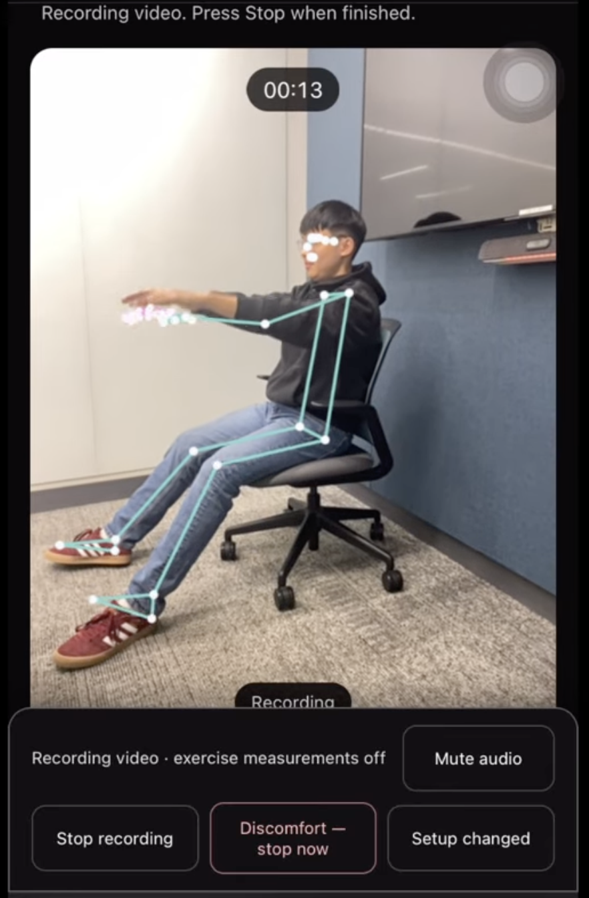

# SCOOT

**Helping stroke survivors and clinicians review seated exercises with a phone camera, joint measurements, and explainable AI summaries.**

## The problem

For stroke survivors practicing clinician-assigned seated exercises, a repetition count alone leaves important questions unanswered: How far did the arm move? Did the torso lean forward? How long did the reach take? A video can capture the movement, but finding and comparing those details takes careful review.

## How SCOOT helps

SCOOT is an experimental prototype for recording a short seated exercise and reviewing what happened alongside the video. Stroke survivors can see their tracked movement, while a supervising clinician can inspect joint angles, displacement, timing, and the exact moments that need a closer look.

The phone calculates movement measurements locally. Optional Gemini summaries explain the recorded facts, while visible tracking limits show where evidence is missing. The goal is to support conversations about assigned exercises; clinical interpretation stays with the treating team.

## Demo



Live recording with a tracking overlay. This quick-recording view has calibrated exercise measurements off; pace monitoring runs separately. A demo video will replace this screenshot.

## From seated practice to clinician review

1. **Choose a seated exercise:** forward reach, elbow bend, arm raise, knee extension, single-leg lift, or ankle pumps.
2. **Open the camera:** see body and hand landmarks before recording. Complete exercise-specific calibration for full measurements.
3. **Record up to 30 seconds:** local analysis runs alongside video capture, with captions, spoken-cue integration, and prominent Stop, Discomfort, and Setup changed controls.
4. **Review the evidence:** replay the video alongside movement summaries, charts, tracking coverage, and timestamped events. Calibrated sessions support explicit local Save; quick recordings support replay and video download.

## The math behind the joints

To make exercise review explainable, each reported measurement follows a defined pipeline:

**Landmarks → intrinsic-frame pixels → quality checks → fixed calibration → geometry → repetition states → validated metrics → review criteria.**

Normalized landmarks become pixels using the inference frame's width and height. Analysis stays unmirrored; preview transforms preserve anatomical left/right. For seated reach, calibration fixes the resting shoulder, elbow, wrist and hip, target **T**, and reference length **L = ‖C₂ − C₁‖** between two calibration points for the entire attempt. Here **H** is the hip, **W₀** the resting wrist, **α₀** the resting torso inclination, and **s = sign(Tₓ − W₀ₓ)** the forward direction.

### Four seated-reach measurements

**1. Projected elbow angle.** With shoulder **S**, elbow **E**, and wrist **W**, the dot product measures the angle at the elbow:

$$\theta = \arccos\left(\operatorname{clamp}\left(\frac{(S-E)\cdot(W-E)}{\|S-E\|\|W-E\|},-1,1\right)\right)\frac{180}{\pi}$$

A projected straight arm approaches 180°. Invalid or near-zero limb vectors are rejected before division.

**2. Torso inclination change.** The shoulder–hip line is compared with its resting baseline, retaining the calibrated forward direction:

$$\alpha = \operatorname{atan2}(S_x-H_x,-(S_y-H_y))\frac{180}{\pi},\qquad \Delta\alpha = s\,\operatorname{wrapTo180}(\alpha-\alpha_0)$$

Report the maximum positive forward change, clipped at zero.

**3. Forward wrist displacement.** Project movement onto the fixed rest-to-target direction and normalize by the fixed reference:

$$d=\frac{T-W_0}{\|T-W_0\|},\qquad f(t)=\frac{(W(t)-W_0)\cdot d}{L}$$

Results use **reference lengths**, not centimeters. Forward displacement is distinct from total displacement or path length.

**4. Reach duration.** Use monotonic capture timestamps in milliseconds from movement onset to first confirmed target entry, excluding target hold and return:

$$t_{\text{reach}}=\frac{t_{\text{target}}-t_{\text{onset}}}{1000}\ \text{seconds}$$

All three geometric peaks use that same outward interval. These are **2D kinematic estimates**, not force, muscle activation, or a clinical range-of-motion examination. Each other exercise has its own joint definitions and endpoint rules.

### Turning movement into trustworthy repetitions

The reach state machine follows **REST → OUTWARD → TARGET → RETURN**, with rest reacquisition after interruptions. Time-based dwell and hysteresis prevent jitter or a held target from adding repetitions. Quality gates check landmark visibility, finite geometry, elapsed-time coverage, and tracking gaps. Unavailable measurements retain null values and reasons.

Only measurable attempts receive configured review flags, using strict full-precision comparisons; equality does not exceed a threshold. Counts preserve **detected = measurable + excluded**. Flags request human review rather than declaring movement correct or safe.

A separate calibration-free pace monitor estimates angular and limb-normalized linear speeds using actual elapsed time, smoothing, and bounded gap handling. Its experimental warning thresholds are separate from calibrated reach criteria.

See the [measurement guide](tasks/seated-reach-measurement-guide.md) for the full geometry, calibration, quality gates, and repetition contract. The [exercise library](tasks/seated-exercise-library.md) defines each exercise; these design documents include historical requirements that may differ from the current app.

## Explaining results and keeping video and clinical notes local

Stroke survivors and their supervising clinician can review the local report without Gemini. When enabled and configured, Gemini receives allowlisted finalized facts to produce a structured explanation. Quick-recording reports contain a headline, range of motion, speed/control, event-linked alerts, tracking quality, and clinician review points. Responses are validated on the server and in the browser; rejected output leaves the local report available.

Video and raw landmarks stay on-device. Real clinical notes stay local. Gemini TTS receives approved cue identifiers through a server adapter; captions and browser speech provide fallback paths. API keys remain server-side.

## Built with

**TypeScript · HTML · Vite · MediaPipe Pose/Hand Landmarker · Web Workers/WASM · MediaRecorder · IndexedDB · Gemini API · Vercel**

## Run locally

Requires **Node 22.13+ within Node 22**, npm 10, and a camera-capable browser.

```sh
npm ci
npm run app:dev
```

Run repository checks with `npm run check`. Optional server-side Gemini configuration is documented in [.env.example](.env.example); provider access is disabled by default. The Vite development server alone does not run the serverless Gemini endpoints.

See the [documentation index](docs/README.md) for architecture, measurement contracts, and verification evidence.

## Current limits

Designed around seated exercise review for stroke survivors. This experimental prototype is not clinically validated and does not replace individualized rehabilitation guidance. Camera view, occlusion, and tracking quality limit the measurements; a camera cannot detect pain. Physical-device audio and camera behavior need further verification, particularly spoken playback and close-view ankle tracking. Browser storage can be cleared or evicted. Public video sharing and cross-session comparisons are not implemented.
