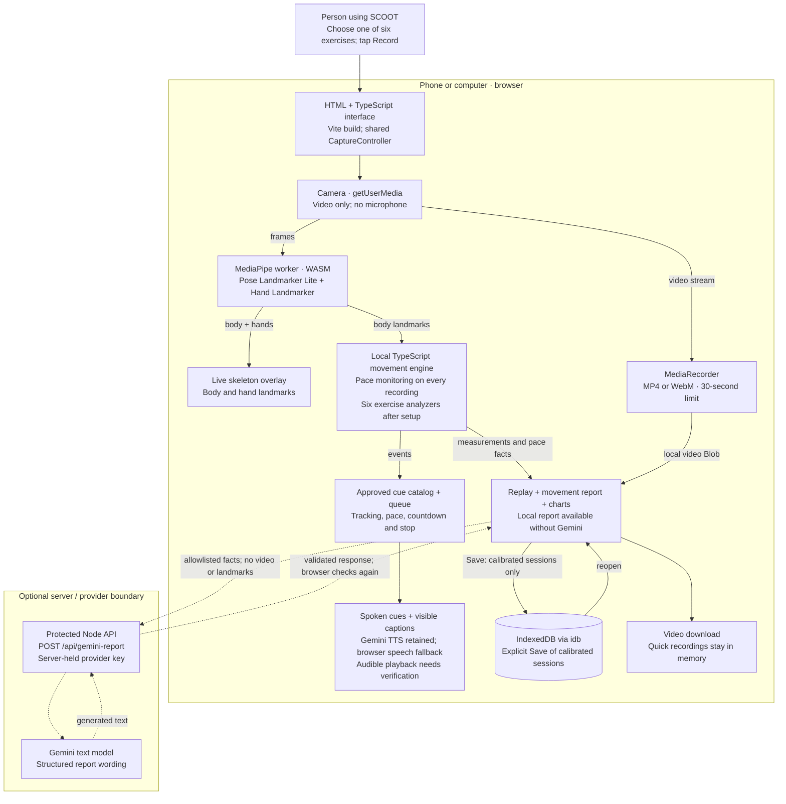
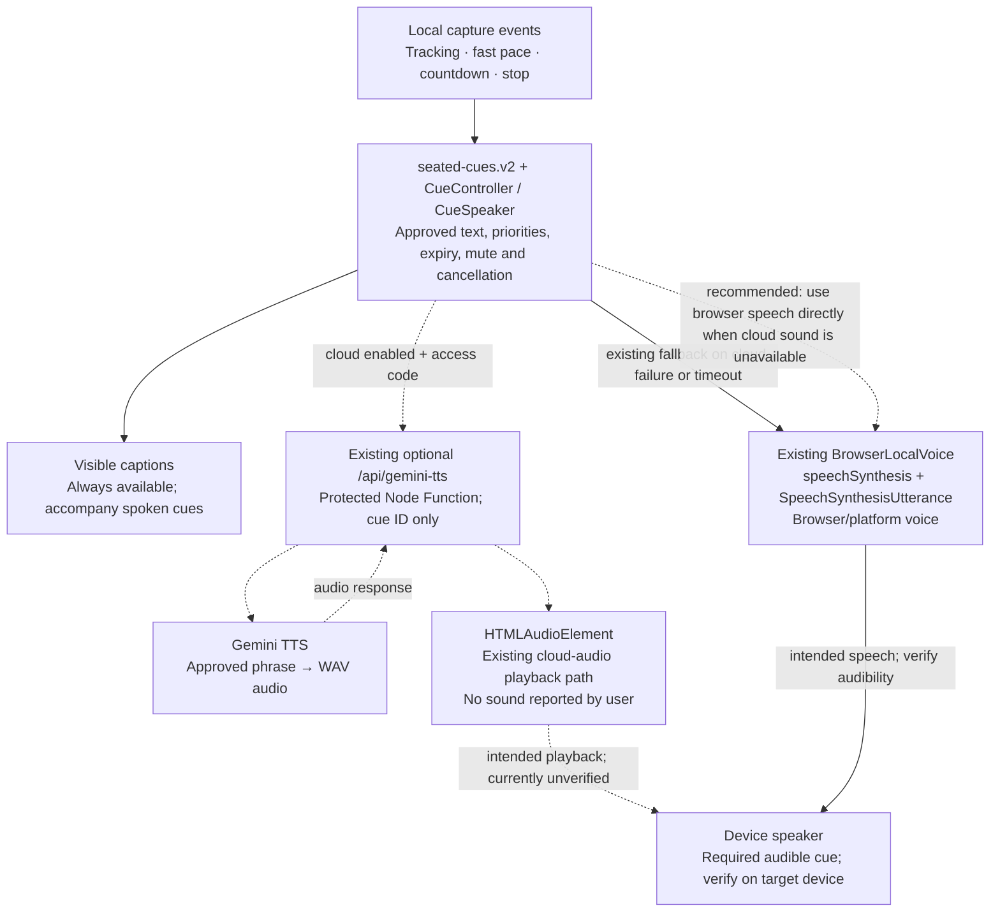

# SCOOT architecture

Checked October 25, 2026 against source commit `7643cc5`.

SCOOT is a browser application for recording seated exercises, tracking movement, giving spoken cues, and reviewing video alongside movement summaries. Most processing happens in the browser. Optional Gemini services supply generated report text and cue audio.

**Latest audio decision:** retain the existing Gemini TTS integration. Its audible playback is currently reported as not working. Spoken cues are required; displaying text alone does not satisfy that requirement. The recommended audio fix is to make the existing browser/platform speech fallback reliably speak when Gemini audio is unavailable, while retaining captions. This document describes the fix; it does not implement it or claim sound has been verified.

## System map

Solid arrows show implemented local data paths. Dashed arrows show optional provider requests, not verified live-service success. The audio detail below distinguishes the reported failure from the recommended fix.

Hosting/build: Vite produces `dist/app`; esbuild bundles the worker and copies models/WASM to same-origin `/pose/`. `vercel.json` configures Vercel static hosting plus Node Functions. Deployment-trigger commits exist, but this review does not establish the current live deployment or provider configuration. The browser's same-origin connection policy also blocks MediaPipe SDK telemetry; it is not a guarantee that platform speech voices never use a remote service.

## Audio detail: retained integration and fix needed

The current code enables audio from the **Record tap**; a separate Enable audio step is no longer required. The cue queue preserves captions, mute/replay, expiry, priority and immediate cancellation when the session stops or changes. No microphone is needed.

The proposed fix keeps Gemini TTS intact and checks both playback routes: confirm actual speech from a Record gesture, handle playback/synthesis errors and unavailable voices visibly, and fall back promptly to browser speech. If neither route can speak, show an explicit audio-unavailable state; captions remain accessible, but that state does not meet the spoken-cue requirement. Verify a real spoken phrase, not just a caption, a resolved API request or the mock provider's tone.

Browser speech is the lowest-change alternative because `BrowserLocalVoice` already exists. Its present implementation does not explicitly select an installed local voice. Platform voices may be local or remote, and availability can change asynchronously. Do not promise offline speech or identical voices across devices. If guaranteed local speech becomes a requirement, select/test a voice with `localService === true` or consider reviewed bundled recordings as a separate future decision. [Official Web Speech API specification](https://webaudio.github.io/web-speech-api/#speechsynthesis) defines voice availability, `voiceschanged`, `localService`, and synthesis error events.

## What each component does

| Component | Technology | Plain-language purpose / current limit |
| --- | --- | --- |
| Interface and capture coordinator | HTML, TypeScript, Vite; shared `CaptureController` | Handles exercise selection, camera, recording lifecycle, setup and review. React remains a reference/regression consumer, not the shipped interface. |
| Camera, live overlay and recorder | `getUserMedia`, Canvas, `MediaRecorder`, HTML video | Shows the person and skeleton; records a local video for replay. Uses available MP4/WebM support. Stops at 30 seconds, with a last-five-second countdown. |
| Tracking worker | `@mediapipe/tasks-vision` 1.1.1, Pose Landmarker Lite, Hand Landmarker, WASM | Finds body/hand landmarks away from the UI thread. CPU is the current default. Hand points draw the overlay; body points drive measurements. Frames and raw landmarks do not enter Gemini. |
| Movement engine | TypeScript geometry, tracking-quality gates and state machines | Always monitors pace from body landmarks. Full setup/calibration additionally enables the matching exercise analyzer. These are engineering estimates, not validated clinical assessments. |
| Speech | Versioned cue catalog, queue, Gemini TTS adapter, browser SpeechSynthesis | Speaks approved cues rather than generating new movement advice. Gemini remains integrated; reported silence and reliable audible fallback are unresolved. |
| Results and reports | Deterministic templates, source-backed charts, Zod schemas, two report contracts | Presents local facts, replay times and charts. Optional Gemini report text is validated on the server and in the browser and bound to the exact input digest. Rejection leaves local results available. |
| Local storage | IndexedDB through `idb` | Explicitly saves calibrated-session facts, video, context and accepted explanation. Quick recordings currently support in-memory review and video download only. Browser deletion/eviction can lose saved data. |
| Optional API and provider | Node Functions, Gemini REST API | Separate report and TTS endpoints keep keys server-side. Access code, exact-origin checks, payload validation, limits and timeouts protect the endpoints. Provider mode defaults disabled; mock responses are not live-provider evidence. |
| Delivery and verification | Vite/esbuild, Vercel configuration; Vitest, Testing Library, Playwright | Builds static assets and API functions. Tests cover modules and browser flows; physical-device audio/camera/storage and actual live-provider behavior require separate evidence. |

The six exercise analyzers cover forward reach, elbow bend/straighten, arm raise, knee extension, single-leg lift and ankle pumps. The user selects the exercise; an AI classifier does not choose it.

## Two recording paths

1. **Quick recording:** choose an exercise, open the camera, wait for a visible pose, tap Record. Video and calibration-free pace monitoring run together. After Stop, show replay, angle/speed charts, warning timestamps and a local summary. If Gemini is already enabled with an access code, this path automatically requests optional report text. The take remains in memory; download preserves its video.
2. **Calibrated measurement:** complete the exercise-specific setup before Record. The appropriate analyzer produces validated attempts, metrics and exclusions, with source-linked charts/replay. Explicit Save writes the session and video to IndexedDB. Optional explanation requests use the measured-session report controller.

Both paths share the camera, worker, recorder, pace monitor and cue system. Tracking visibility alone does not establish a valid calibrated repetition. Reports are derived from movement facts, not a Gemini video upload.

Real patient/clinician context stays local. Only explicitly selected fictional fixture context may accompany measured-session report facts; the server rejects real context. Quick-recording report requests carry only their allowlisted movement summary, without free text.

## Changes from previous designs

| Previous design or stale note | Latest implementation / decision |
| --- | --- |
| React-first app | Root app is HTML + TypeScript; shared engines remain framework-independent. |
| Jev/TypeSafe exercise classification | Retired from the active flow. Manual selection is authoritative; unused local recognition code is not an active runtime service. |
| Setup required before any recording | Quick recording starts after pose detection. Calibration is required for the full exercise measurements, not for recording and pace monitoring. |
| Body tracking only | Body and hand tracking now support the overlay; analysis still uses body points. |
| 60-second sessions | Actual recording limit is 30 seconds. |
| Separate Enable audio action | Record tap now enables the existing audio system. Audible output still needs verification. |
| Earlier request to remove Gemini TTS | Superseded by the user's clarification: retain Gemini TTS. Make the existing browser speech route deliver audible fallback; captions alone are insufficient. No replacement cloud TTS vendor is selected. |
| A report only after calibrated exercise analysis | Quick recordings also produce pace reports, timelines and charts; optional Gemini wording is requested automatically when enabled/configured. |
| All recordings saved locally | Calibrated sessions have IndexedDB Save. Quick recordings currently have replay/download without that Save path. |
| Public video sharing / cloud storage | Unavailable in the current app. No public-storage provider, central session database or cloud sync is part of this implementation. |

## Evidence and verification boundary

This is an architecture/documentation review, not a new application test run or a sound fix. Findings were checked against current source and independently audited. Older October 25 integration notes predate the latest quick-recording, hand-tracking, report and 30-second changes; source code takes precedence where they disagree. Physical iPhone audio/camera/storage, clinical readiness and live Gemini behavior are not established here.

Primary source locations:

- [Root interface and audio/report wiring](../src/capture/developer-demo.ts), [Vite entry/build configuration](../vite.config.ts).
- [Capture coordinator](../src/features/practice/capture-controller.ts), [recording limit and cue events](../src/contracts/cue-events.ts), [recorder](../src/capture/recorder.ts).
- [Body/hand worker](../src/pose/pose-worker.ts), [overlay](../src/pose/preview.ts), [pace monitor](../src/analysis/pace-monitor.ts).
- [Cue controller](../src/speech/cue-controller.ts), [cue speaker](../src/speech/cue-speaker.ts), [browser/Gemini audio adapters](../src/speech/browser-audio.ts).
- [Quick-recording report contract](../src/contracts/video-report.ts), [report client](../src/report/video-report-client.ts), [measured-session report contract](../src/contracts/provider-report.ts), [report endpoint](../server/gemini/report-endpoint.ts).
- [IndexedDB store](../src/storage/session-store.ts), [Vercel configuration](../vercel.json), [asset build](../scripts/build-app-assets.mjs).
